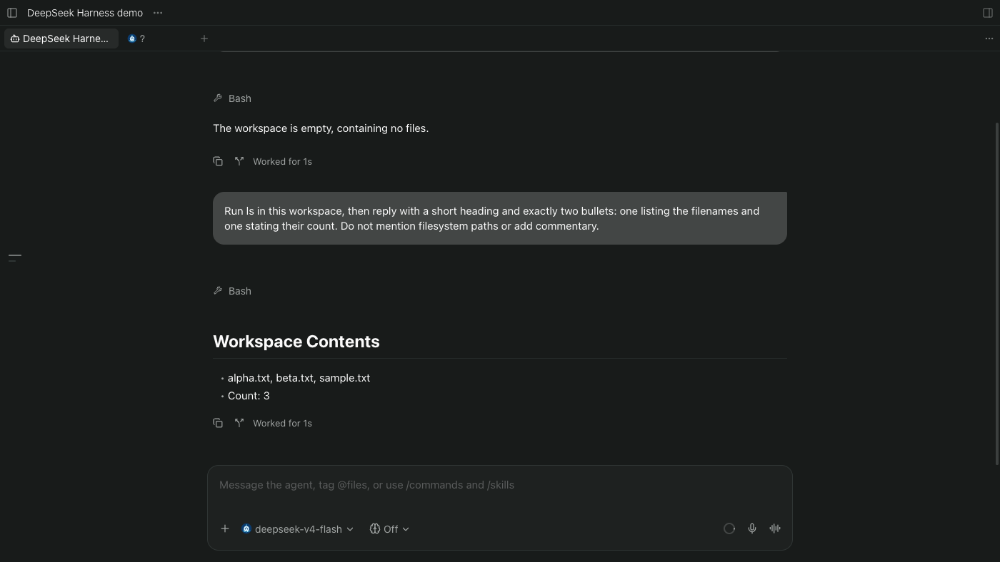

# DeepSeek Harness for Paseo

**Use the official DeepSeek Harness in Paseo — with native context resume and complete tool results.**

A community-maintained provider plugin for Paseo 0.11 and later, not a
replacement agent loop or an official DeepSeek/Paseo endorsement. It runs
`dsh --profile acp`; Paseo owns the chat UI. No custom client surface or
patched Paseo app is required.

*Real hosted Paseo web-client capture using synthetic prompts and a `/tmp` workspace. The model picker is closed because Paseo displays the opaque ACP route ID when it is open. [Screenshot provenance](https://github.com/geoqiao/paseo-stuff/blob/main/plugins/deepseek-harness/docs/screenshots.md).*

[Install](#install-prerequisites) · [Compatibility](#acp-compatibility-and-limitations) · [Verification](https://github.com/geoqiao/paseo-stuff/blob/main/plugins/deepseek-harness/docs/verification.md) · [Code review](https://github.com/geoqiao/paseo-stuff/blob/main/plugins/deepseek-harness/docs/code-review.md)

> [!IMPORTANT]
> **Requirements:** Paseo 0.11.0 or later (tested Paseo versions are listed
> under [Paseo installation](#paseo-installation)), daemon Node.js 22.19.0 or
> newer, and a separately installed official DeepSeek Harness executable,
> **DSH 0.1.5-rc.1 or newer**. Newer DSH releases are accepted without an
> exact-version check. Tested: **0.1.5-rc.1**, **0.1.5-rc.2**, **0.1.6-alpha.2**,
> **0.1.7-alpha.2**, **0.1.7-rc.1**, **0.1.7-rc.2**, **0.2.0-rc.1**,
> **0.2.0-rc.2**, **0.2.1-rc.2** and **0.2.1-rc.3**. The executable must be able to run
> `dsh --profile acp --version` and `dsh --profile acp`.
> On Paseo 0.8 to 0.10, install beta.12 instead:
> `paseo plugin add geoqiao/paseo-stuff:plugins/deepseek-harness --ref deepseek-harness-v0.1.0-beta.12`.

## What it does

- Registers provider ID deepseek-harness with Paseo.
- Launches `dsh --profile acp` through Paseo's provider launch: the daemon
  finds `dsh` on its PATH or uses your command override, and the plugin starts
  it with the SDK process helpers. Those helpers run Windows `.cmd` launchers
  and stop the whole process tree on Windows.
- Reports the DeepSeek API balance in Paseo's **Usage** panel.
- Uses Paseo's public runAcpProvider shim for ACP lifecycle, permissions,
  prompts, timeline mapping, usage and configuration.
- Presents DSH's live model and reasoning-effort options without rewriting
  their wire IDs. DSH model IDs are opaque JSON strings.
- Passes configured MCP servers, images, environment variables and working
  directories to DSH session runtimes.
- Keeps complete raw tool output. The adapter maps an ACP tool update whose
  output is represented by typed content blocks, but has no rawOutput, to
  rawOutput: { content: ... } without flattening or truncating it.

## Install prerequisites

Install a verified official DSH version **on the daemon machine**, then check
that the daemon can find the executable on its PATH. The npm `latest` dist-tag
currently resolves to `0.2.1-rc.2` and `next` to `0.2.1-rc.3`; both are tested:

~~~sh
npm install -g --ignore-scripts @deepseek-ai/dsh@0.2.1-rc.2
dsh --version
~~~

Configure a DeepSeek key through official DSH **Settings → Models** (`dsh web`),
or its documented environment/configuration mechanism. The official local
store is `$DSH_HOME/.credentials.yaml`, with owner-only permissions on POSIX.
See the [official model configuration guide](https://github.com/deepseek-ai/deepseek-harness/blob/183f08e9c6dde7e36cd2318eaee70b0da08fb35e/docs/user/guide/providers.md).

The plugin does not download, install, update or restart DSH. DSH itself owns
credentials and provider configuration. The plugin does not mirror sessions or
read private DSH transcripts.

For the Usage panel, the plugin looks up `DEEPSEEK_API_KEY` the way DSH does:
the daemon environment first, then `$DSH_HOME/.credentials.yaml`, then
`$DSH_HOME/.env` (`DSH_HOME` defaults to `~/.dsh`). It sends the key only to
`https://api.deepseek.com/user/balance` and does not store it. The panel shows
the balance in the account's currency, for example `¥13.26`. Paseo 0.12.0-beta.3
links usage sources only to built-in providers, so the balance appears in the
global Usage panel and not in an agent's own usage view.

By default the daemon finds `dsh` on its PATH and runs `dsh --profile acp`.
To use another installation or profile, set Paseo's standard provider command
override in the daemon's `config.json` and run `paseo reload`:

~~~json
{
  "agents": {
    "providers": {
      "deepseek-harness": {
        "command": ["/opt/dsh/bin/dsh", "--profile", "acp"]
      }
    }
  }
}
~~~

The array replaces the whole default command, so keep `--profile` with a
profile that speaks ACP over stdio, not the web/TUI profile. Custom profiles
are untested. Beta.12 and earlier read `DSH_PASEO_COMMAND` and
`DSH_PASEO_PROFILE` instead; move those values into `command`. Variables under
`agents.providers.deepseek-harness.env` reach every DSH process. Session
runtimes also get per-session Paseo overrides, so variables such as `DSH_HOME`
are preserved for the session.

The verified runtime compositions use CLI `0.1.5-rc.1` or `0.1.5-rc.2` with
`@deepseek-ai/dsh-acp` `0.1.5-rc.2`, CLI `0.1.6-alpha.2` with
`@deepseek-ai/dsh-acp` `0.1.6-alpha.2`, the isolated published CLI/ACP
closures `0.1.7-alpha.2`, `0.1.7-rc.1`, `0.1.7-rc.2`, `0.2.0-rc.1`,
`0.2.1-rc.2` and `0.2.1-rc.3`, and the global CLI `0.2.0-rc.2`; all use
ACP SDK `1.4.0`. The plugin probes the CLI version and rejects only releases
older than `0.1.5-rc.1` or output it cannot parse. Newer releases are accepted
but untested until listed here; ACP behaviour follows the capabilities DSH
advertises; resuming against a peer without `session/resume` fails with a clear error.

## ACP compatibility and limitations

DSH advertises session/resume but not ACP's older top-level loadSession
capability. Paseo's public ACP shim (0.8 through 0.12.0-beta.3) uses session/load when
it sees persistence. A small typed stdio adapter therefore does the following:

1. After initialize, if the peer has session/resume and does not have
   loadSession, it exposes loadSession only to the private shim-facing
   stream.
2. It translates that stream's session/load request to session/resume,
   keeping the same session ID, cwd, MCP servers, request ID and other fields.
3. It does not synthesize transcript replay. DSH resumes context without
   replaying old updates.
4. It never retries with a new session after a resume error.

All other ACP frames pass through unchanged except for the narrow tool-output
projection described above. Existing rawOutput wins, including null.
Permission, error, cancellation, image, MCP, response and notification
payloads are not flattened or discarded. The provider deliberately does not
advertise or implement raw token deltas, commands, steering, plans,
terminals, elicitation, client filesystem operations or other unsupported DSH
surfaces. DSH model and reasoning configuration is exposed when the ACP
server advertises it. The public ACP shim emits complete timeline snapshots;
this plugin does not claim token-level or UI streaming.

DSH's ACP bridge gives a message's reasoning and answer chunks the same
`messageId`. ACP treats chunks with one `messageId` as one message, so Paseo's
shim would show the reasoning again inside the answer. The plugin appends
`:thought` to nonempty thought-chunk IDs and leaves answer IDs unchanged; see
[docs/compatibility.md](docs/compatibility.md). The issue is reported upstream
as [deepseek-harness#8235](https://github.com/deepseek-ai/deepseek-harness/discussions/8235),
and the shim will be removed once DSH sends distinct IDs.

The plugin has no local persistence layer, no daemon-side DSH session mirror,
no custom persona or provider preset, and no permission-policy override.
Activity or another Paseo client may choose how to preview a complete tool
result; this provider does not truncate it.

The native Paseo timeline works without another plugin. Optional
[Readable Agent Activity](https://github.com/geoqiao/paseo-stuff/tree/main/plugins/agent-activity)
adds bounded readable previews; **that separate renderer** requires Full detail.

**Displayed history after a reload:** when Paseo reopens a session, after
`paseo agent reload` or a daemon restart, it rebuilds the timeline from the
provider's replay and deletes the timeline it stored. DSH does not replay, so
on Paseo 0.12.0-beta.2 and 0.13.0 the agent keeps its DSH context but shows an
empty timeline. Paseo 0.13.0 restores history that an ACP agent replays during
`session/load` (getpaseo/paseo#7717); DSH resumes with `session/resume`, which
replays nothing, so that fix does not apply. Reloading the plugin keeps the timeline.

**Known side effects and boundaries:** catalog discovery uses ACP `session/new`
and can leave empty sessions in DSH's native session list. DSH profile settings
remain authoritative; the generic ACP shim does not inject Paseo's extra
`systemPrompt`. Real vision/MCP services, custom profiles, Windows and native
iOS/Android clients have not been exercised. See [verification](https://github.com/geoqiao/paseo-stuff/blob/main/plugins/deepseek-harness/docs/verification.md).

## Paseo installation

Review this trusted, unsandboxed plugin and install it on the intended daemon.
On Paseo 0.11 or later, the reviewed [registry](https://paseo.sh/plugins) entry
`geoqiao/deepseek-harness` installs the pinned npm package:

~~~sh
paseo plugin add geoqiao/deepseek-harness --host <your-host>
paseo plugin ls --host <your-host>
~~~

To install the published npm package directly, run:

~~~sh
paseo plugin add paseo-deepseek-harness --host <your-host>
paseo plugin ls --host <your-host>
~~~

Paseo installs this package's runtime dependencies. The package omits the Git
source build because that build runs `npm ci` and `npm run check`, which require
the lockfile, tests and development dependencies; those are not included in the
npm package. The `paseo-plugin.json` in the Git source retains those build steps.

To install the pinned Git prerelease instead, run:

~~~sh
paseo plugin add git:geoqiao/paseo-stuff:plugins/deepseek-harness --ref deepseek-harness-v0.1.0-beta.13 --host <your-host>
paseo plugin ls --host <your-host>
~~~

Paseo 0.11 reads a bare `owner/name` source as a registry ID, so the `git:`
prefix is required. If the registry install fails with "npm artifact changed
since review", the daemon's npm uses a registry mirror; see
[the fix](https://github.com/geoqiao/paseo-stuff#if-a-registry-install-fails-with-npm-artifact-changed-since-review).

Select **DeepSeek Harness** when creating an agent in Paseo. Model and thinking
choices come from the installed DSH profile. Plugins and DSH tools are trusted,
unsandboxed code; file permissions do not hide credentials from tools running
as your OS user. This adapter does not add a security sandbox.

The source manifest requires `>=0.11.0`, the first release whose SDK supplies
the resolved launch, the process helpers, provider `status()` and usage
sources. Under Paseo's requirements contract, a minimum-only range admits
0.11.0 and every later release, including prereleases and future breaking
releases; it is not a promise that untested versions work. Beta.13 is tested
with the 0.11.4 SDK and on live 0.11.4, 0.12.0-beta.2 and 0.13.0 daemons on
macOS; its checks also pass with the 0.13.0 SDK. Do not restart the daemon for this plugin. Follow Paseo's
global plugin-enable and per-installation
enable/disable rules; an existing disabled installation should remain
disabled unless the user explicitly enables it.

For local development, run the checks below and install this plugin directory
by its absolute path. Existing Git installations do not switch sources or pinned
tags automatically.

## Development and test entry point

The production entry is index.server.ts. The reusable server-side factory is
server/provider.ts:

- `createDeepSeekHarnessProvider(options?)` returns a public
  `ProviderRegistration` plus an idempotent async `dispose()`;
- `createProvider` is an alias;
- `createDshAcpStream` and `createAcpCompatibilityStream` are exported from
  `server/dsh-compatibility.ts` for focused ACP and lifecycle tests.

This makes an independent temporary script able to call the same
ProviderRegistration.connect, send, onEvent and close path used by Paseo.
Call `await provider.dispose()` when the owner stops, including if a connection
is still being established or the host has already started closing it. The
production entry does this in its async cleanup. Supply a key only in the child environment when performing an opt-in
real-model check; do not persist it in this repository.

From this directory:

~~~sh
npm ci --ignore-scripts --legacy-peer-deps --no-audit --no-fund
npm run typecheck
npm run lint
npm test
~~~

The tests use the installed public Paseo SDK (pinned to 0.11.4), public
`runAcpProvider`, ACP SDK 1.4.0 framing, and a fake ACP peer process. They cover catalog discovery,
model and thinking options, multi-turn prompts, configuration, persistence
resume, tool output fidelity, images, MCP, permissions, errors, cancellation,
EOF and startup cleanup, concurrent environment/cwd isolation, unsupported
capabilities, direct stream guards, and public-provider close during version
probe, initialize, and prompt. Real DSH/model credentials are intentionally
not part of the automated fixture.

## Verification record

Automated checks use `npm run typecheck`, `npm run lint` and `npm test`.
The [verification record](https://github.com/geoqiao/paseo-stuff/blob/main/plugins/deepseek-harness/docs/verification.md) distinguishes fake-peer protocol
tests, real official-API calls, actual daemon integration and untested clients.

A separate live check in the parent workspace exercised this production
provider factory through the public Paseo SDK and the official DSH ACP peer.
It ran three real-inference rounds for each of CLI `0.1.5-rc.1` and
`0.1.5-rc.2` (the recorded four-model/v4-flash, reasoning-off checks passed),
including two-turn memory, file write/read, a complete tool-output tail over
8,000 characters, and recovery of the same persistence context after both the provider
and DSH processes restarted. Five usage events were received in each run; emitted events
validated with the public `ProviderEventSchema`. Both installation closures
resolved to DSH ACP `0.1.5-rc.2` and ACP SDK `1.4.0`.

The beta.4 local migration then ran the same production provider factory on
Node 22.23.2 with isolated CLI `0.1.5-rc.2` and the upgraded global CLI
`0.1.6-alpha.2`. Both completed catalog discovery, session configuration, one
bounded synthetic no-tools prompt, usage/timeline validation and clean close;
the prompt produced no permission event. The exact closure and ACP probe are
recorded in [verification](https://github.com/geoqiao/paseo-stuff/blob/main/plugins/deepseek-harness/docs/verification.md). No daemon reload, enable,
disable or restart was performed for this migration.

A follow-up Node 24.21.0 check completed the latest alpha.2 persistence
regression: teardown closed all six owned ACP profile children, reopening used
the returned persistence through the real `session/resume` bridge, and a second
prompt recalled its marker without repeating it. A temporary read-only file
probe also verified typed raw tool output under the existing policy without a
permission response or approval change.

The beta.5 upstream check installed the published `0.1.7-alpha.2` CLI closure
in an isolated `DSH_HOME`. Its ACP initialize response retained `session/list`,
`session/resume`, and `session/close`; the production provider factory completed
initialize and clean close through Paseo's public shim. No model prompt or paid
inference was attempted. The exact-version guard now accepts this release while
retaining the existing resume bridge and tool-output fidelity path.

The beta.6 upstream check installed the published `0.1.7-rc.1` CLI/ACP closure
in an isolated `DSH_HOME`. Its ACP initialize response retained `session/list`,
`session/resume`, and `session/close`; a bounded `session/list` returned an empty
catalog, and the production provider factory completed capability mapping and
clean connection/provider close through Paseo's public shim. No model prompt,
tool execution, approval, credential or paid inference was attempted.

The beta.7 upstream check installed the published `0.1.7-rc.2` CLI/ACP closure
in an isolated `DSH_HOME` on Node 24.18.0. It reported the exact version; its
ACP initialize response retained `session/list`, `session/resume`, and
`session/close`, and a temporary session closed and resumed in the same and a
fresh process. With the guard updated, the production provider factory mapped
capabilities, returned an empty session list and a three-model catalog, and
closed and disposed cleanly without leftover processes through Paseo's public
shim. No model prompt, tool execution, approval, credential or paid inference
was attempted, and the signed-in account model catalog was not checked.

The beta.8 check installed the published `0.2.0-rc.1` CLI closure (ACP SDK
`1.4.0`) in an isolated home on Node 24.18.0. Beta.7's exact-version guard
rejected it. With the minimum-only guard, the production provider factory
mapped the same capabilities and three-model catalog as an `0.1.7-rc.2`
control run, listed sessions and closed without leftover processes. No model
prompt, tool execution, credential or paid inference was attempted.

Separately, an installed macOS Paseo 0.8.0 daemon completed real turns and kept
tool-output tails, prior displayed history and DSH context through a plugin
disable/enable cycle. An initial host IPC shutdown race was fixed by explicit
async cleanup ownership; the repeated installed cycle had no new IPC errors,
and the following real turn retained context and history. The current **65-test** suite
includes pending-connect and close-ordering regressions; exact evidence is
tracked in [verification](https://github.com/geoqiao/paseo-stuff/blob/main/plugins/deepseek-harness/docs/verification.md).
The [post-release review](https://github.com/geoqiao/paseo-stuff/blob/main/plugins/deepseek-harness/docs/code-review.md) adds diagnostic-redaction, timeout,
missing-workspace and defensive-input regressions without changing the ACP mappings.
These are backend tests, not a desktop UI matrix or mobile-device test. Official DSH does not provide raw token deltas,
provider-specific commands, steering, transcript replay, or its own plan/
terminal UI surfaces; those are not claimed by this plugin. Credentials and
private session contents are not stored in the repository.

## Community catalog

The original paseo.cafe [PR #87](https://github.com/paseo-cafe/paseo-cafe/pull/87)
was merged. Migration to this monorepo is a separate registry change that retains
the existing `deepseek-harness` catalog ID. The entry uses the
`provider` category and flags prerequisites, beta compatibility, safety,
persistence semantics, unsupported surfaces and verification limits. Its source
is [the catalog entry](https://github.com/geoqiao/paseo-stuff/blob/main/plugins/deepseek-harness/docs/catalog-entry.json); publication of this plugin
and acceptance into the community catalog are separate actions.

## License

MIT. DeepSeek Harness and its official packages remain under their own
licenses.
